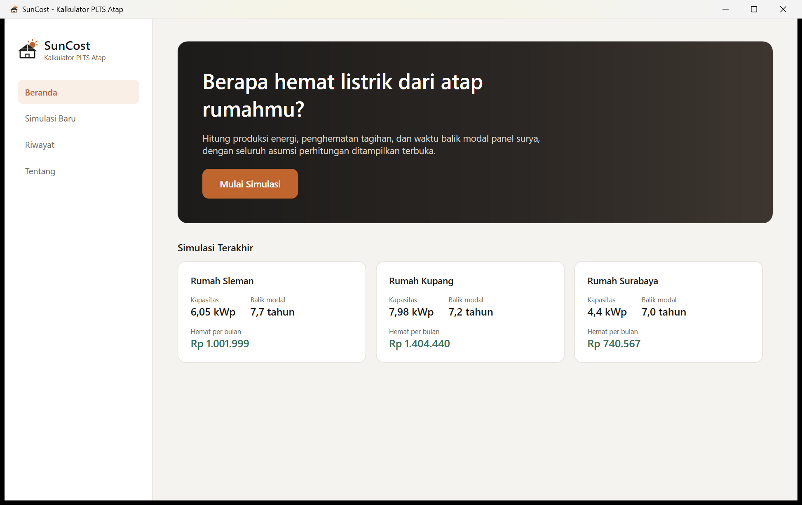
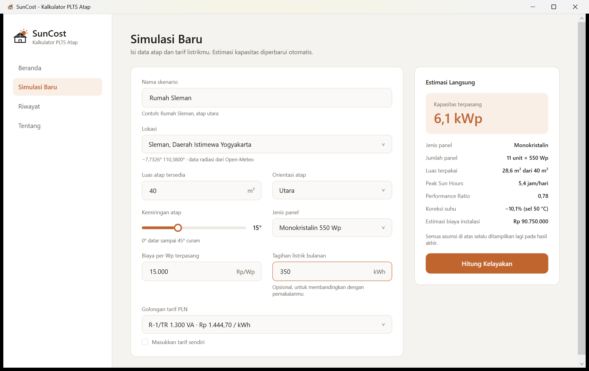
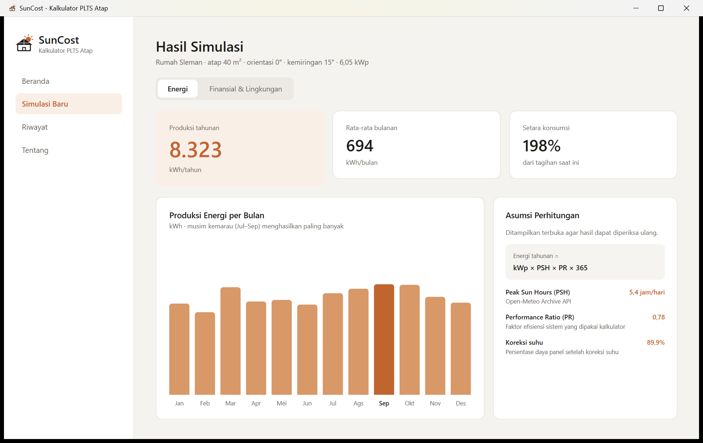
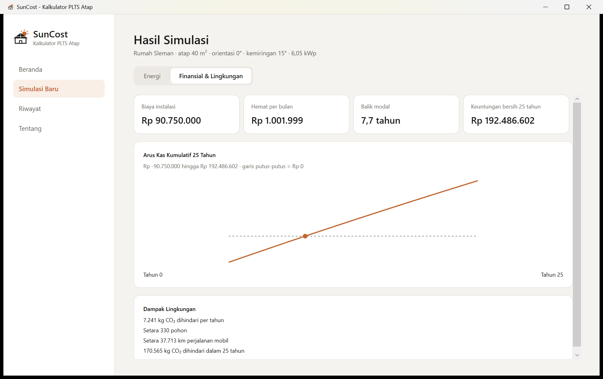
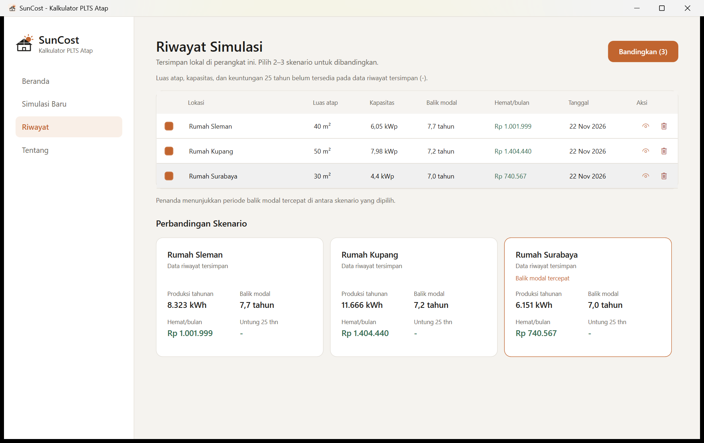
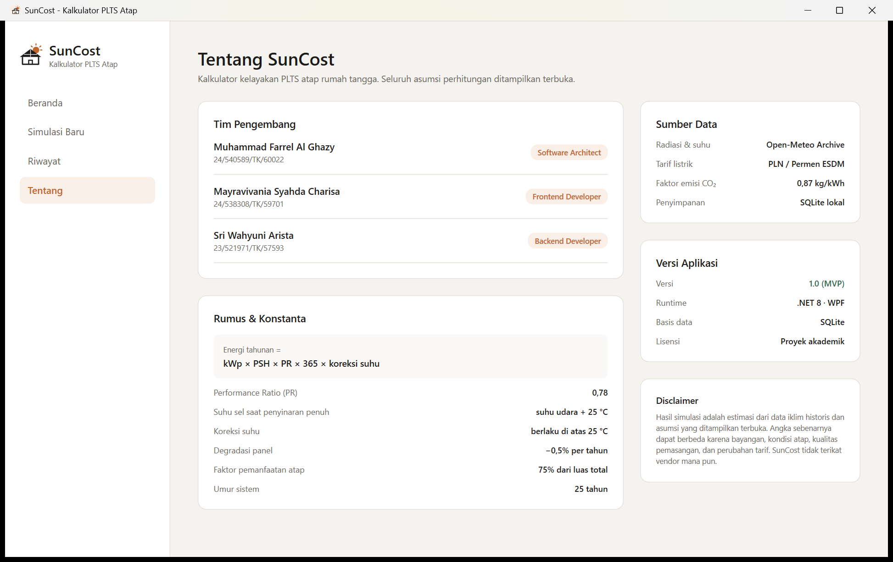

<p align="center">
  
</p>

<h1 align="center">SunCost</h1>

<p align="center"><b>Kalkulator kelayakan PLTS atap rumah tangga, dengan seluruh asumsi ditampilkan terbuka.</b></p>

<p align="center">
  
  
  
  
  
</p>

SunCost memberi tahu pemilik rumah tiga hal sebelum memasang panel surya: berapa listrik yang
dihasilkan atapnya, berapa rupiah yang dihemat tiap bulan, dan kapan biaya instalasinya kembali.
Angkanya dihitung dari data radiasi matahari satu tahun terakhir di lokasi pengguna (Open-Meteo),
spesifikasi panel, dan tarif PLN. Setiap asumsi perhitungan ditampilkan di layar, sehingga hasilnya
bisa diperiksa ulang, bukan sekadar dipercaya.

| | |
|---|---|
| **Jenis** | Aplikasi desktop Windows (C# WPF, .NET 8) |
| **Kategori** | Climate Action, energi terbarukan |
| **Data** | Open-Meteo Archive API (gratis, tanpa API key) dan SQLite lokal |
| **Butuh internet?** | Hanya untuk mengambil radiasi lokasi baru. Data yang sama dipakai ulang 30 hari, dan riwayat selalu bisa dibuka offline. |
| **Mata kuliah** | Junior Project, Teknik Basis Data dan Pemrograman Berbasis Objek |

---

## Daftar isi

- [Permasalahan](#permasalahan)
- [Fitur](#fitur)
- [Tangkapan layar](#tangkapan-layar)
- [Cara kerja](#cara-kerja)
- [Menjalankan aplikasi](#menjalankan-aplikasi)
- [Pengujian](#pengujian)
- [Struktur repositori](#struktur-repositori)
- [Dokumentasi](#dokumentasi)
- [Tim](#tim)

---

## Permasalahan

Indonesia menerima radiasi matahari rata-rata 4–5 kWh/m²/hari, tetapi PLTS atap masih kecil
dibanding jumlah rumah yang bisa memasangnya:

| Yang terjadi | Angka | Sumber |
|---|---|---|
| PLTS atap terpasang di pelanggan PLN | **538 MWp** dari **10.882 pelanggan** per Juli 2025 | Kementerian ESDM, via [Kontan](https://industri.kontan.co.id/news/realisasi-terpasang-plts-atap-sebesar-538-mwp-hingga-juli-2025) |
| Seluruh PLTS Indonesia (atap + skala besar) | **1,59 GW** per kuartal I 2026, dengan PLTS atap sebagai porsi terbesar (0,9 GW) | IESR, via [pv magazine](https://www.pv-magazine.com/2026/11/19/indonesia-could-reach-96-7-gw-of-solar-by-2029-with-policy-reforms/) |
| Target pemerintah | **100 GW** PLTS | IESR, via [Katadata](https://katadata.co.id/berita/energi/6afef813b9677/iesr-kapasitas-plts-ri-baru-1-59-gwp-butuh-percepatan-capai-target-100-gwp) |

Hambatan bagi rumah tangga lebih banyak soal informasi daripada teknologi. Calon pengguna tidak
tahu berapa listrik yang bisa dihasilkan atapnya dan kapan modalnya kembali. Datanya tersebar di
citra satelit berformat teknis, lembar spesifikasi panel, dan tarif listrik yang berubah-ubah.
Akibatnya mereka bergantung pada estimasi vendor, yang cenderung optimistis dan tidak transparan.

### Pembanding

| Aplikasi | Kelebihan | Keterbatasan |
|---|---|---|
| Google Project Sunroof | Citra udara dan model 3D atap, termasuk bayangan | Hanya di Amerika Serikat dan Jerman |
| PVGIS (Uni Eropa) | Data satelit akurat dan gratis | Antarmuka teknis, tanpa analisis finansial dengan tarif PLN |
| NREL PVWatts | Standar rujukan produksi PV | Untuk pengguna teknis, asumsi biaya pasar Amerika Serikat |
| Kalkulator vendor lokal | Berbahasa Indonesia | Asumsi tertutup dan cenderung optimistis karena bertujuan menjual |

**Pembeda SunCost:** berbahasa Indonesia, memakai tarif PLN dan iklim tropis, membuka semua
asumsinya, dan netral karena tidak terikat vendor mana pun.

---

## Fitur

| Fitur | Yang terjadi |
|---|---|
| **Simulasi baru** | Pilih kota, isi luas atap, orientasi, kemiringan, jenis panel, biaya per Wp, dan golongan tarif PLN (atau tarif sendiri). Kapasitas, jumlah panel, dan biaya diperbarui langsung saat mengetik. |
| **Data radiasi lokasi** | Peak Sun Hours tiap bulan dan suhu rata-rata diambil dari arsip satu tahun Open-Meteo di latar belakang, tanpa membekukan jendela. |
| **Cache offline** | Radiasi yang sudah pernah diambil untuk koordinat yang sama dipakai ulang selama 30 hari, jadi simulasi kedua langsung jadi tanpa internet. |
| **Hasil energi** | Produksi tahunan, rata-rata bulanan, persentase terhadap pemakaian, grafik produksi 12 bulan, dan panel asumsi (PSH, PR, koreksi suhu). |
| **Finansial dan lingkungan** | Biaya instalasi, hemat per bulan, periode balik modal, keuntungan bersih 25 tahun, grafik arus kas kumulatif, serta CO₂ yang dihindari, setara pohon, dan setara kilometer mobil. |
| **Dua jenis panel** | Monokristalin dan thin film punya rumus koreksi suhu sendiri (polimorfisme `PanelSurya`). |
| **Riwayat** | Setiap simulasi tersimpan di SQLite. Hasilnya bisa dibuka ulang, dihapus dengan konfirmasi, atau 2–3 skenario dibandingkan berdampingan dengan penanda balik modal tercepat. |
| **Data cadangan** | Kalau API tidak terjangkau, simulasi tetap berjalan dengan rata-rata Indonesia dan diberi banner peringatan yang jelas. |
| **Tentang** | Tim, sumber data, dan seluruh konstanta. Angkanya dibaca langsung dari kode mesin hitung, jadi tidak pernah basi. |

---

## Tangkapan layar

Diambil dari aplikasi yang berjalan, dengan tiga skenario contoh: Sleman, Kupang, dan Surabaya.

<table>
  <tr>
    <th width="50%">Beranda: simulasi terakhir</th>
    <th width="50%">Simulasi Baru: estimasi langsung</th>
  </tr>
  <tr>
    <td></td>
    <td></td>
  </tr>
  <tr>
    <th>Hasil: tab Energi</th>
    <th>Hasil: tab Finansial &amp; Lingkungan</th>
  </tr>
  <tr>
    <td></td>
    <td></td>
  </tr>
  <tr>
    <th>Riwayat: banding tiga skenario</th>
    <th>Tentang: rumus dan konstanta</th>
  </tr>
  <tr>
    <td></td>
    <td></td>
  </tr>
</table>

---

## Cara kerja

### Satu simulasi, langkah demi langkah

```
Pilih kota ──► LayananCuacaAPI.ambilDataRadiasiAsync()
                 ├─ cache SQLite < 30 hari?  ──► pakai (tanpa internet)
                 ├─ Open-Meteo Archive 1 tahun ──► PSH 12 bulan + suhu rata-rata
                 └─ gagal ──► data cadangan 4,5 PSH, 27 °C + banner peringatan

Isi form ──► KalkulatorEnergi    : luas efektif → jumlah panel → kWp → produksi bulanan
             AnalisisFinansial   : biaya, hemat per bulan, payback dengan degradasi, arus kas 25 tahun
             DampakLingkungan    : CO₂ dihindari, setara pohon, setara km mobil

Hitung ──► SimulasiSkenario.jalankanSimulasi() ──► RepositoriSimulasi.simpan() ──► HasilPage
```

### Rumus

```
Kapasitas (kWp)  = jumlah panel × Wp per panel / 1000
                   jumlah panel = ⌊ luas atap × 0,75 / luas per panel ⌋
Energi bulanan   = kWp × PSH bulan × hari × PR × koreksi suhu × faktor orientasi
Koreksi suhu     = 1 − koefisien × (suhu udara + 25 °C − 25 °C)      (monokristalin)
Balik modal      = tahun saat penghematan kumulatif (turun 0,5%/tahun) ≥ biaya instalasi
```

### Asumsi

Semua angka berikut ada di kode sebagai `public const` dan ditampilkan di halaman Tentang.
Alasannya dicatat di [ADR 0001](docs/decisions/0001-asumsi-perhitungan.md).

| Asumsi | Nilai | Letak di kode |
|---|---|---|
| Performance Ratio | 0,78 | `KalkulatorEnergi.PerformanceRatio` |
| Suhu sel saat penyinaran penuh | suhu udara + 25 °C (pendekatan NOCT) | `KalkulatorEnergi.KenaikanSuhuSel` |
| Suhu referensi koreksi | 25 °C | `PanelSurya.SuhuReferensi` |
| Faktor pemanfaatan atap | 75% | `Lokasi.FaktorPemanfaatan` |
| Degradasi panel | 0,5% per tahun | `AnalisisFinansial.DegradasiBawaan` |
| Umur sistem | 25 tahun | `AnalisisFinansial.UmurSistemTahun` |
| Faktor emisi jaringan Jawa-Bali | 0,87 kg CO₂/kWh (KESDM) | `DampakLingkungan.FaktorEmisiBawaan` |
| Tarif PLN | tetap selama 25 tahun, tanpa diskonto | |

Radiasi pada bidang miring didekati dengan koreksi geometris terhadap posisi ideal (menghadap
ekuator, kemiringan sebesar lintang). Pendekatan ini sederhana dan cenderung konservatif.

### Arsitektur

| Lapisan | Isi |
|---|---|
| `Models/` | Entitas: `Lokasi`, `PanelSurya` (abstrak) → `PanelMonokristal` / `PanelThinFilm`, `DataRadiasi`, `TarifListrikPLN`, `SimulasiSkenario` |
| `Services/` | Logika: kalkulator energi, analisis finansial, dampak lingkungan, layanan cuaca, repositori SQLite, riwayat |
| `Views/` | Halaman WPF. Tidak menghitung dan tidak menulis SQL sendiri. |

Basis data memakai enam tabel ([ERD](docs/ERD.md)): `lokasi`, `panel_surya`,
`tarif_listrik_pln`, `data_radiasi`, `radiasi_bulanan`, `skenario`.

<details>
<summary>Class diagram</summary>


</details>

---

## Menjalankan aplikasi

### Pilihan 1: jalankan `.exe` (tanpa memasang apa pun)

1. Ambil `SunCost.exe` hasil build (lihat [pilihan 3](#pilihan-3-membuat-exe-sendiri)).
2. Klik dua kali. Kalau Windows SmartScreen muncul, pilih **More info → Run anyway**, karena
   berkasnya belum ditandatangani.

`.exe` sudah membawa runtime .NET 8 dan library SQLite, jadi laptop tujuan tidak perlu memasang
apa pun.

### Pilihan 2: dari kode sumber

**Prasyarat:** Windows 10/11 dan [.NET 8 SDK](https://dotnet.microsoft.com/download/dotnet/8.0).
Cek dengan `dotnet --version`, hasilnya harus `8.x`.

```powershell
git clone https://github.com/Yeypayeyy/22_SunCost.git
```
```powershell
cd 22_SunCost
```
```powershell
dotnet run
```

Paket NuGet (`Microsoft.Data.Sqlite`) dipulihkan otomatis saat build pertama. Bisa juga dibuka di
Visual Studio 2022: buka `SunCost.csproj`, lalu tekan **F5**.

### Pilihan 3: membuat `.exe` sendiri

```powershell
dotnet publish -c Release -r win-x64 --self-contained true -p:PublishSingleFile=true -p:IncludeNativeLibrariesForSelfExtract=true -p:EnableCompressionInSingleFile=true
```

Hasilnya satu berkas, sekitar 70 MB, di `bin\Release\net8.0-windows\win-x64\publish\SunCost.exe`.
`IncludeNativeLibrariesForSelfExtract` wajib ada, supaya library native SQLite ikut terbawa.

### Basis data

Tidak ada yang perlu dikonfigurasi. Berkas `%LOCALAPPDATA%\SunCost\suncost.db` dibuat otomatis
saat aplikasi pertama kali dibuka, lengkap dengan data awal panel dan tarif PLN. Cara melihat,
mencadangkan, dan mengosongkannya ada di
[Panduan Konfigurasi Basis Data](docs/panduan-basis-data.md).

---

## Pengujian

**Black box (Modul 10):** 29 kasus uji untuk seluruh halaman, validasi, data cadangan, cache, dan
instalasi ada di [docs/specs/pengujian.md](docs/specs/pengujian.md)
([versi .docx](docs/pengujian-blackbox-suncost.docx)), dengan format Lab 10.2.

**White box:** `Services/SelfCheck.cs` berisi 96 pemeriksaan `Debug.Assert`. Pemeriksaan ini berjalan otomatis
setiap kali aplikasi dibuka dalam build Debug (`dotnet run`). Kalau satu pemeriksaan gagal,
aplikasi berhenti sebelum jendela terbuka, sehingga rumus yang rusak tidak lolos tanpa
ketahuan.

| Area | Contoh yang diperiksa |
|---|---|
| Perhitungan energi | 40 m² dengan panel 550 Wp menghasilkan 11 panel dan 6,05 kWp. Koreksi suhu 27 °C menghasilkan 0,892. Produksi tahunan sama dengan jumlah 12 bulan dan wajar (1.050–1.600 kWh/kWp). |
| Polimorfisme panel | Monokristalin dan thin film memberi koreksi suhu berbeda untuk input yang sama. |
| Finansial | Payback dengan degradasi lebih lama dari pembagian sederhana. Arus kas menyilang nol di tahun yang sama dengan payback. |
| Lingkungan | Total emisi 25 tahun mengikuti deret geometrik degradasi. |
| Basis data | Migrasi dari skema lama tanpa kehilangan data, data awal tidak tergandakan, skenario dirakit utuh saat dimuat, hapus tidak meninggalkan baris yatim. |
| Cache radiasi | Data di bawah 30 hari dipakai ulang. Data lama, data cadangan, dan koordinat lain tidak. |
| Dropdown | Panel dan tarif dari database, tanpa baris milik skenario seperti "Tarif manual". |

Pengujian basis data memakai berkas sementara di `%TEMP%`, sehingga data pengguna tidak tersentuh.

---

## Struktur repositori

```
SunCost/
├── App.xaml(.cs)            gaya bersama dan titik masuk (menjalankan SelfCheck di Debug)
├── MainWindow.xaml(.cs)     kerangka: sidebar dan area konten
├── Models/                  entitas domain
├── Services/                mesin hitung, API cuaca, repositori SQLite, SelfCheck
├── Views/                   Beranda, Simulasi Baru, Hasil, Riwayat, Tentang
├── Assets/                  ikon aplikasi dan ilustrasi
└── docs/
    ├── ERD.md               rancangan basis data dan DDL
    ├── panduan-basis-data.md
    ├── decisions/           ADR: asumsi perhitungan, pilihan SQLite
    ├── plans/               pembagian kerja FE dan BE
    ├── specs/               peta layar UI ke Figma
    └── screenshots/
```

---

## Dokumentasi

| Dokumen | Isi |
|---|---|
| [docs/ERD.md](docs/ERD.md) | Diagram, kardinalitas, dan DDL SQLite enam tabel |
| [docs/panduan-basis-data.md](docs/panduan-basis-data.md) | Lokasi berkas, migrasi otomatis, cara melihat dan mencadangkan data |
| [docs/specs/pengujian.md](docs/specs/pengujian.md) | 29 kasus uji black box (format Modul 10) |
| [ADR 0001](docs/decisions/0001-asumsi-perhitungan.md) | Asumsi perhitungan yang dipakai dan alasannya |
| [ADR 0002](docs/decisions/0002-database-sqlite.md) | Mengapa SQLite lokal, beserta alternatif yang ditimbang |
| [docs/specs/layar-ui.md](docs/specs/layar-ui.md) | Peta frame Figma ke halaman WPF dan token desain |
| [docs/README.md](docs/README.md) | Pembagian tugas dan status keluaran Modul 10 |

---

## Tim

| Nama | NIM | Peran |
|---|---|---|
| Muhammad Farrel Al Ghazy | 24/540589/TK/60022 | Ketua · Software Architect + Frontend |
| Mayravivania Syahda Charisa | 24/538308/TK/59701 | Frontend Developer |
| Sri Wahyuni Arista | 23/521971/TK/57593 | Backend Developer |

Proyek akademik Junior Project, Laboratorium Informatika. Hasil simulasi adalah estimasi dari data
iklim historis dan asumsi yang ditampilkan terbuka. Angka sebenarnya dapat berbeda karena
bayangan, kondisi atap, kualitas pemasangan, dan perubahan tarif.
