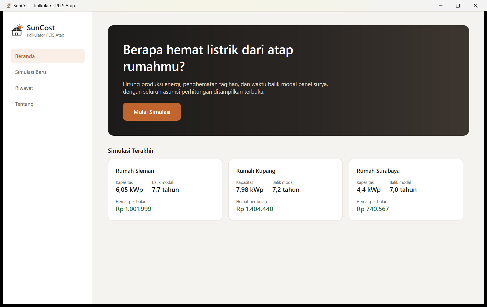
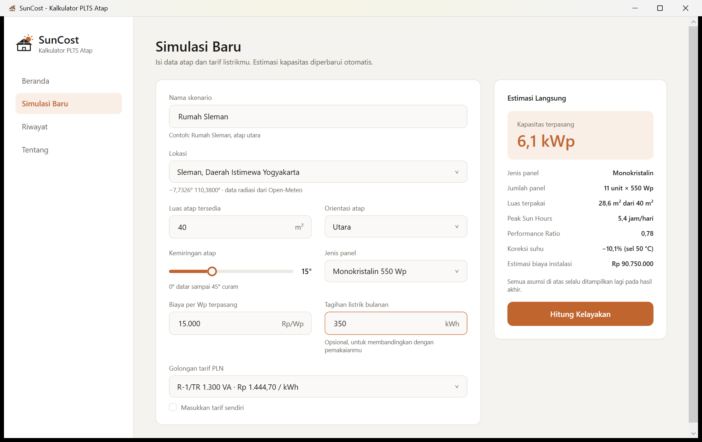
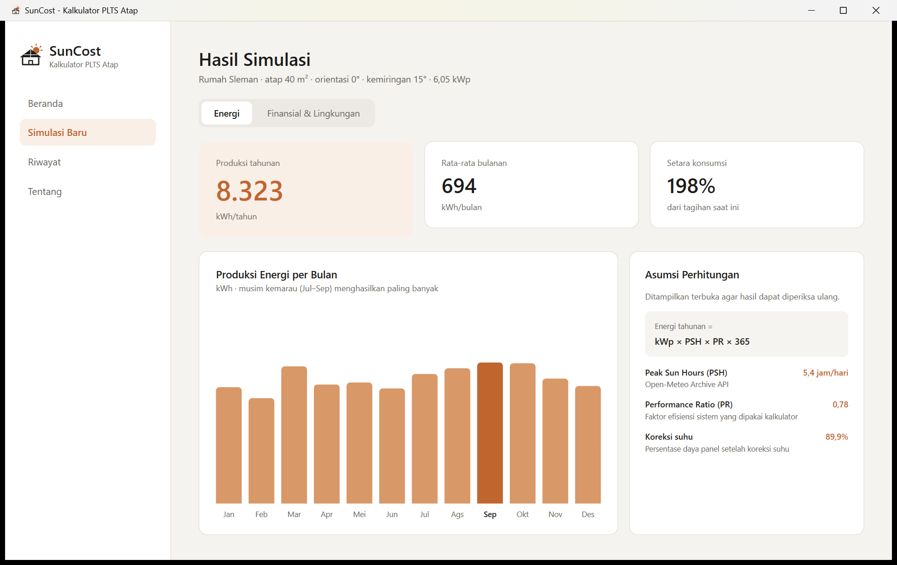
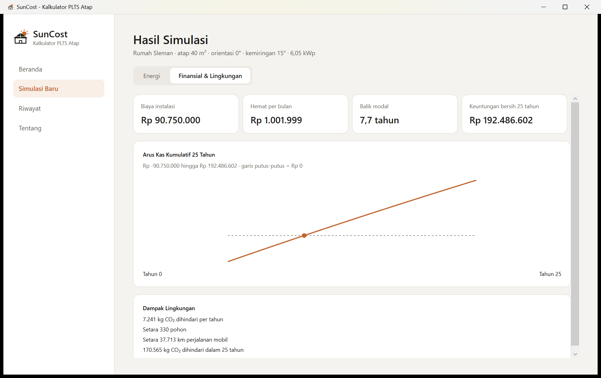
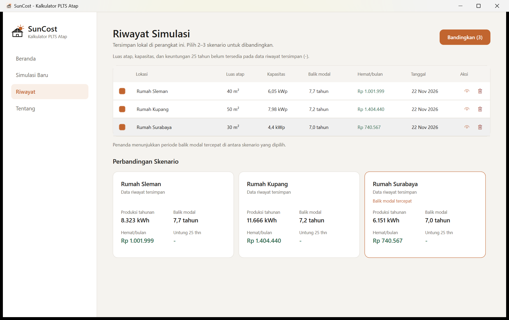
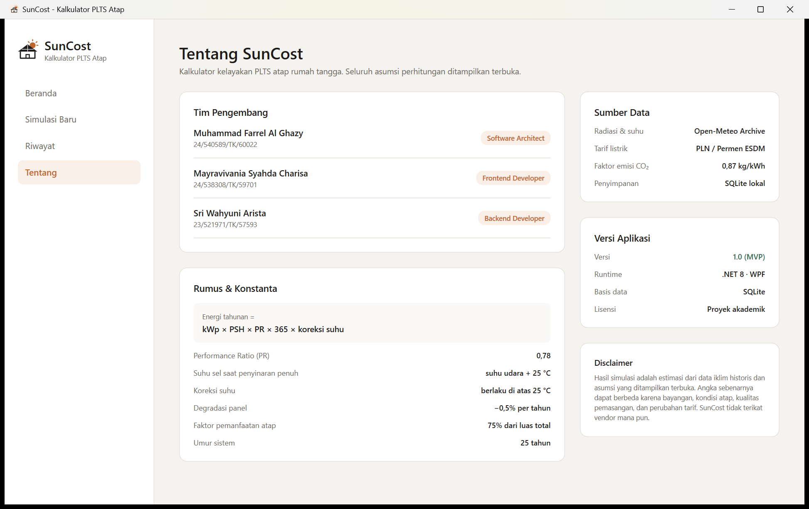

# Panduan Singkat Penggunaan SunCost

SunCost membantu menghitung apakah panel surya di atap rumah layak dipasang: berapa listrik yang
dihasilkan, berapa rupiah yang dihemat tiap bulan, dan kapan biaya pemasangannya kembali.
Panduan ini membahas langkah dari membuka aplikasi sampai membandingkan beberapa skenario.

## 1. Membuka aplikasi

1. Klik dua kali **`SunCost.exe`**. Tidak perlu memasang .NET atau basis data.
2. Kalau muncul peringatan **Windows protected your PC**, klik **More info → Run anyway**.
   Peringatan ini muncul karena berkasnya belum ditandatangani, bukan karena berbahaya.
3. Saat pertama dibuka, SunCost membuat tempat penyimpanan riwayat secara otomatis di
   `%LOCALAPPDATA%\SunCost\suncost.db`. Tidak ada yang perlu diatur.

Koneksi internet dibutuhkan hanya untuk mengambil data radiasi matahari sebuah kota untuk
pertama kali. Lihat [bagian 7](#7-tanpa-internet).

## 2. Beranda

Menu di kiri dipakai untuk berpindah halaman: **Beranda**, **Simulasi Baru**, **Riwayat**, dan
**Tentang**. Beranda menampilkan tiga simulasi terakhir (kapasitas, balik modal, hemat per bulan).
Klik **Mulai Simulasi** untuk membuat perhitungan baru.

## 3. Membuat simulasi

Isi formulir dari atas ke bawah:

| Isian | Yang diisi | Contoh |
|---|---|---|
| **Nama skenario** | Nama bebas supaya mudah dikenali di Riwayat | `Rumah Sleman, atap utara` |
| **Lokasi** | Kota terdekat. Data radiasi kota ini langsung diambil di latar belakang. | Sleman |
| **Luas atap tersedia** | Luas bagian atap yang bisa dipasangi panel, dalam m² | `40` |
| **Orientasi atap** | Arah hadap atap. Di Indonesia (selatan khatulistiwa), atap menghadap **utara** paling baik. | Utara |
| **Kemiringan atap** | Geser 0° (datar) sampai 45° (curam) | 15° |
| **Jenis panel** | Monokristalin (efisien, umum dipakai) atau thin film (lebih tahan panas) | Monokristalin 550 Wp |
| **Biaya per Wp terpasang** | Harga pemasangan per watt-peak dari penawaran vendor, sudah termasuk inverter dan jasa | `15.000` |
| **Tagihan listrik bulanan** | *Opsional.* Pemakaian listrik per bulan dalam kWh, lihat struk atau aplikasi PLN Mobile | `350` |
| **Golongan tarif PLN** | Golongan daya rumah, misalnya R-1/1.300 VA | R-1/TR 1.300 VA |

Panel **Estimasi Langsung** di kanan berubah setiap kali isian diubah: kapasitas (kWp), jumlah
panel yang muat, luas terpakai, dan perkiraan biaya. Kalau angkanya sudah sesuai, klik
**Hitung Kelayakan**.

**Tarif sendiri.** Kalau tarif listrikmu berbeda dari daftar, centang **Masukkan tarif sendiri**,
lalu isi tarif per kWh. Dropdown golongan akan nonaktif dan hasil memakai tarif yang kamu isi.

**Kalau ada isian yang salah**, kolomnya bergaris merah dengan pesan di bawahnya, misalnya
*"Luas atap harus lebih dari 0 m²."*, dan tombol Hitung tidak bisa ditekan sampai isian diperbaiki.

## 4. Membaca hasil

Setelah Hitung ditekan, halaman Hasil Simulasi muncul. Simulasi otomatis tersimpan ke Riwayat.

### Tab Energi

- **Produksi tahunan**: listrik yang dihasilkan panel dalam setahun (kWh).
- **Rata-rata bulanan**: produksi per bulan.
- **Setara konsumsi**: persentase pemakaianmu yang bisa ditutup panel. Kalau tagihan bulanan tidak diisi, kolom ini tampil "—".
- **Grafik 12 bulan**: produksi tiap bulan. Batang tertinggi adalah bulan paling cerah.
- **Asumsi Perhitungan**: angka yang dipakai menghitung (Peak Sun Hours lokasi, Performance Ratio, koreksi suhu), supaya hasil bisa diperiksa ulang.

### Tab Finansial & Lingkungan

- **Biaya instalasi**: kapasitas × biaya per Wp.
- **Hemat per bulan**: tagihan listrik yang berkurang.
- **Balik modal**: berapa tahun sampai penghematan menutup biaya instalasi. Makin kecil makin baik.
- **Keuntungan bersih 25 tahun**: total penghematan selama umur panel dikurangi biaya instalasi.
- **Arus Kas Kumulatif**: garis naik dari minus (biaya awal) ke plus. Titik yang memotong garis putus-putus adalah saat balik modal.
- **Dampak Lingkungan**: CO₂ yang tidak jadi dilepas, setara jumlah pohon dan kilometer perjalanan mobil.

## 5. Riwayat dan membandingkan skenario

Semua simulasi tersimpan di halaman **Riwayat**, yang terbaru di paling atas.

- **Melihat ulang hasil**: klik ikon **mata** pada baris skenario. Halaman hasil lengkap terbuka lagi.
- **Membandingkan**: centang 2 atau 3 skenario, lalu klik **Bandingkan**. Kartu perbandingan
  muncul di bawah tabel, dan skenario dengan balik modal tercepat diberi penanda
  **Balik modal tercepat**. Paling banyak 3 skenario sekaligus.
- **Menghapus**: klik ikon **tempat sampah**, lalu **Hapus** pada kotak konfirmasi. Klik **Batal**
  kalau tidak jadi. Skenario yang dihapus tidak bisa dikembalikan.

Tips: buat beberapa skenario untuk rumah yang sama dengan pilihan berbeda (luas atap, jenis panel,
arah atap), lalu bandingkan untuk melihat pilihan yang paling cepat balik modal.

## 6. Tentang

Halaman **Tentang** berisi tim pengembang, sumber data, dan seluruh rumus serta konstanta yang
dipakai, misalnya Performance Ratio 0,78 dan faktor emisi 0,87 kg CO₂/kWh.

## 7. Tanpa internet

- Data radiasi sebuah kota yang pernah dihitung **disimpan 30 hari**. Selama itu, simulasi di kota
  yang sama tetap bisa dihitung tanpa internet.
- Riwayat selalu bisa dibuka tanpa internet.
- Kalau internet mati dan kotanya belum pernah dihitung, simulasi tetap berjalan memakai rata-rata
  Indonesia, dengan banner **"Open-Meteo tidak dapat dihubungi"** di atas hasil. Hasilnya kurang akurat.
  Hitung ulang setelah internet tersambung.

## 8. Masalah yang mungkin muncul

| Masalah | Solusi |
|---|---|
| Tombol **Hitung Kelayakan** tidak bisa ditekan | Ada isian bergaris merah. Perbaiki sesuai pesan di bawahnya. |
| Muncul banner **data cadangan** | Internet tidak tersambung saat mengambil data kota itu. Sambungkan internet, lalu hitung ulang. |
| Riwayat menampilkan **"Riwayat tidak dapat dimuat"** | Tutup aplikasi lain yang membuka `suncost.db` (misalnya DB Browser), lalu buka ulang SunCost. |
| Ingin menghapus semua riwayat | Tutup SunCost, hapus berkas `%LOCALAPPDATA%\SunCost\suncost.db`. Berkas dibuat ulang otomatis saat SunCost dibuka. |

Rincian tentang penyimpanan data ada di [Panduan Konfigurasi Basis Data](panduan-basis-data.md).

---

*Hasil simulasi adalah estimasi dari data iklim historis dan asumsi yang ditampilkan terbuka.
Angka sebenarnya dapat berbeda karena bayangan, kondisi atap, kualitas pemasangan, dan perubahan tarif.*
