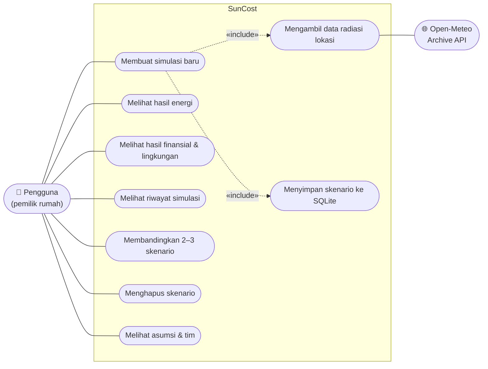

# Use Case Diagram SunCost

SunCost tidak punya login. Aplikasi dipakai satu pengguna di laptopnya sendiri, dan seluruh data
tersimpan lokal di `%LOCALAPPDATA%\SunCost\suncost.db`. Karena itu hanya ada satu aktor utama,
ditambah Open-Meteo sebagai aktor sistem eksternal.

## Diagram (Mermaid)

Mermaid belum punya jenis diagram use case, jadi diagram di bawah memakai flowchart: aktor di
kiri dan kanan, use case berbentuk elips di dalam batas sistem.



## Daftar use case

| Use case | Halaman | Yang terjadi |
|---|---|---|
| Membuat simulasi baru | Simulasi Baru | Pengguna mengisi lokasi, luas atap, orientasi, kemiringan, panel, biaya per Wp, dan tarif PLN, lalu menekan Hitung Kelayakan. |
| Mengambil data radiasi lokasi «include» | (latar belakang) | Radiasi 12 bulan dan suhu rata-rata diambil dari Open-Meteo. Kalau ada cache di bawah 30 hari, cache yang dipakai. Kalau API gagal, dipakai data cadangan dan muncul banner peringatan. |
| Menyimpan skenario ke SQLite «include» | (latar belakang) | Input dan hasil simulasi tersimpan sebagai satu baris `skenario`. |
| Melihat hasil energi | Hasil, tab Energi | Produksi tahunan, rata-rata bulanan, grafik 12 bulan, dan asumsi perhitungan. |
| Melihat hasil finansial & lingkungan | Hasil, tab Finansial & Lingkungan | Biaya, hemat per bulan, balik modal, arus kas 25 tahun, dan CO₂ yang dihindari. |
| Melihat riwayat simulasi | Riwayat, Beranda | Daftar skenario tersimpan, terbaru di atas. Skenario bisa dibuka ulang. |
| Membandingkan 2–3 skenario | Riwayat | Kartu berdampingan dengan penanda balik modal tercepat. |
| Menghapus skenario | Riwayat | Hapus setelah dialog konfirmasi. |
| Melihat asumsi & tim | Tentang | Tim, rumus, konstanta, dan sumber data. |

## Impor ke draw.io

1. Buka draw.io, lalu **Arrange → Insert → Advanced → Mermaid**.
2. Tempel blok mermaid di atas (tanpa pagar ```), lalu klik **Insert**.
